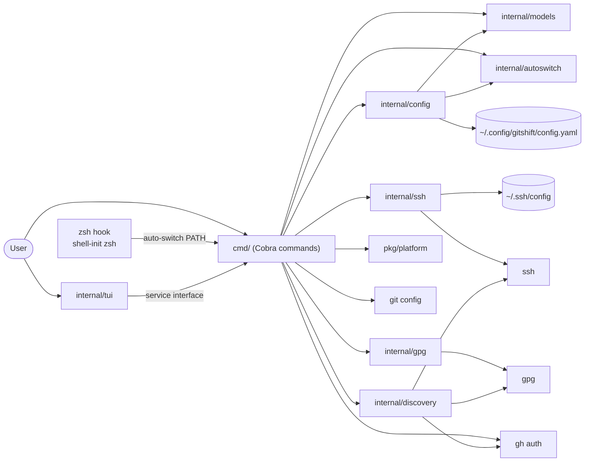
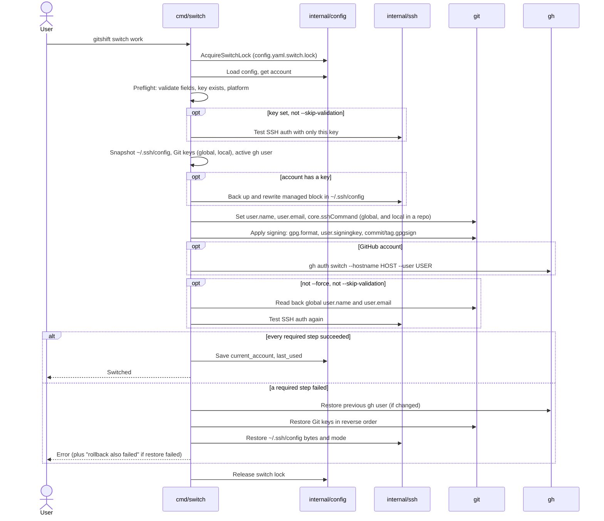

# Architecture

GitShift is a single Go binary built with [Cobra](https://github.com/spf13/cobra). Commands in `cmd/` parse input and orchestrate; packages under `internal/` own persistence and the adapters to external tools. There is no daemon: every invocation, including the shell hook, is a short-lived process that reads the config file, acts, and exits.

## Packages

| Package | Responsibility |
| --- | --- |
| [`cmd/`](../../cmd/) | One file per command. `switch.go` holds the switch transaction shared by the CLI, the UI, auto-switch and first-run discovery. `shell_init.go` prints the zsh hook |
| [`internal/models`](../../internal/models/) | `Config`, `Account`, `AutoSwitchConfig`, `PendingAccount`; field validation (alias, email, username, domain, API endpoint) and key-path normalization |
| [`internal/config`](../../internal/config/) | Loads and saves `config.yaml`: read-only and mutating load paths, version migration, owner-only atomic writes, stale-write detection, the save and switch locks |
| [`internal/autoswitch`](../../internal/autoswitch/) | Canonicalizes directories (absolute, symlinks resolved) and picks the deepest matching rule |
| [`internal/ssh`](../../internal/ssh/) | Rewrites the managed block in `~/.ssh/config` with backups; tests SSH authentication with a single key |
| [`internal/gpg`](../../internal/gpg/) | Generates, exports and tests GPG keys |
| [`internal/git`](../../internal/git/) | Git helpers such as SSH key file checks used by `add` |
| [`internal/discovery`](../../internal/discovery/) | Scanners for GitHub CLI accounts, SSH key pairs (with isolated identity probes) and GPG secret keys, and the merge of their evidence |
| [`internal/tui`](../../internal/tui/) | The Bubble Tea terminal UI. It calls back into `cmd/` through a small service interface, so it uses the same validation and switch code |
| [`pkg/platform`](../../pkg/platform/) | The `github` and `gitlab` providers: default domains and the SSH host for an account |
| [`pkg/gh`](../../pkg/gh/) | A GitHub API client. No current command calls it |
| [`tools/gendocs`](../../tools/gendocs/) | Generates `docs/reference/commands/` from the Cobra tree (`make docs`) |

## The switch transaction

`switchAccount` in `cmd/switch.go` is the only code path that applies an account. The caller holds the switch lock for the whole transaction.

Design points:

- **Validate before mutating.** Field, key and SSH checks run before the snapshot, so a typical failure changes nothing.
- **Persist last.** `current_account` is written only after the external changes, so a failed switch never claims to be active.
- **Compensate, don't pretend to be atomic.** Git, OpenSSH and the GitHub CLI share no transaction. The snapshot-and-restore covers errors returned by a step, not a killed process. See the [security model](security-model.md#backups-and-rollback).
- **One code path.** The UI calls `switchAccount` with no force options. Auto-switch calls it the same way after resolving the target, re-checking the target under the lock so two hooks firing at once do not switch twice.

## Configuration persistence

`internal/config` has two load paths. `LoadReadOnly` reads the file, treats a missing file as empty, and never writes; `current --short`, `auto list`, `auto resolve` and `discover --dry-run` use it, as does the hook's no-match fast path. `Load` creates the file if missing, sets mode `0600`, migrates `config_version` and saves the result.

Every save takes `config.yaml.lock`, re-reads the file and compares its SHA-256 with what was loaded. If they differ it fails with `configuration changed on disk` instead of overwriting. The new content goes to an owner-only temporary file in the same directory, which atomically replaces the old one; the directory is then synced where the OS supports it.

## Auto-switch resolution

`internal/autoswitch` turns the input path into an absolute physical directory and compares it with each rule using `filepath.Rel`, so `/dev/work` contains `/dev/work/api` but not `/dev/work-old`. The deepest match wins. With no match, the command falls back to `auto_switch.default_account`. If the target is empty or already current, `auto-switch` exits without taking any lock or writing anything.

## Discovery

Discovery keys provider identities as `provider|hostname|username`, so two accounts on one host stay separate. It enumerates GitHub CLI users from `gh auth status --json hosts`, reads each profile with that user's token passed only to one `gh api` child, probes each SSH key in isolation to learn which username it authenticates as, and attaches SSH and GPG evidence only when a match is unique. Aliases are planned and validated in `cmd/` before anything is written, and imports are additive unless `--overwrite` is given.
