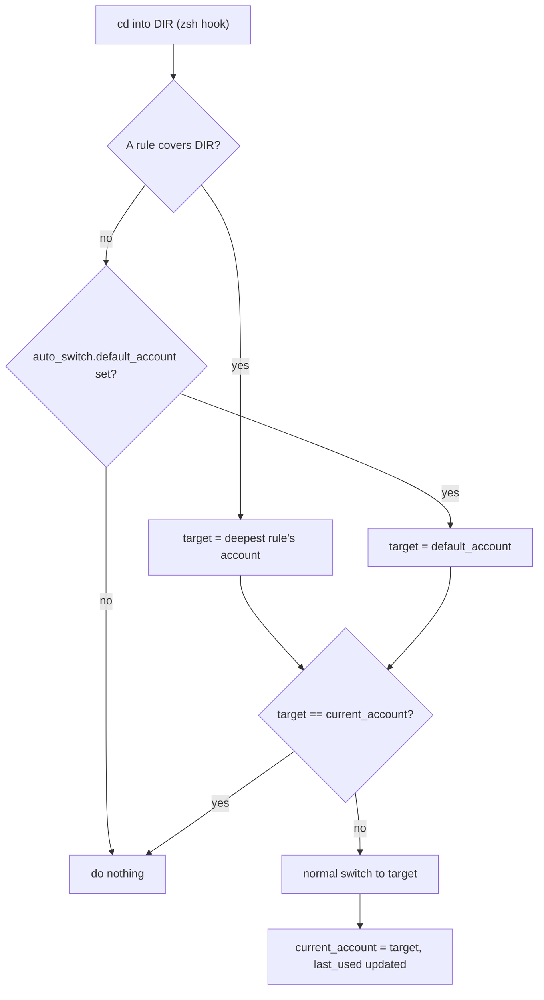
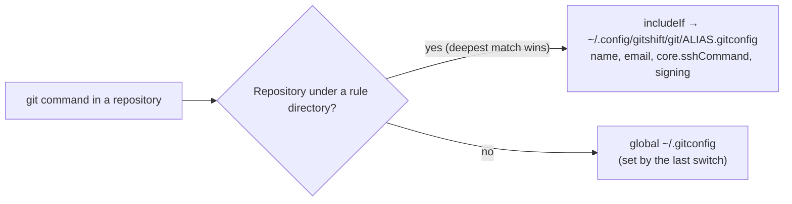

# Identity model

GitShift records three different "which account" values. They are easy to confuse because two of them are called "default".

| Concept | Stored as | Set by | Used for |
| --- | --- | --- | --- |
| Current (applied) account | `current_account` | a successful `switch`: CLI, terminal UI, auto-switch, or first-run `discover` | `current`, `current --short`, `ssh-test` without an alias, the auto-switch "already active" check |
| Default account | `is_default` on one account | the first `add`, `add --default`, `update --default`; switching never changes it | display in `list`, `update` and the UI |
| Auto-switch default | `auto_switch.default_account` | `gitshift auto default ALIAS` | the account the zsh hook applies outside every rule directory |

## Current account

The current account is a record of what GitShift last applied, not a live reading of your system. It is written only after every step of a switch succeeded (or was tolerated by `--force`). Adding or updating an account, even with `--default`, never changes it.

Because it is a record, it can drift. `gh auth switch`, `git config --global user.email ...` or another tool can change your real identity without GitShift knowing. `gitshift current` keeps reporting the last applied alias until the next switch.

If you remove the current account, `current_account` is cleared and `gitshift current` reports that no account is set. Your Git and SSH settings still hold that account's identity until you switch.

## Default account

The default account is a marker GitShift keeps on exactly one account. No command applies it automatically: it does not select an account at startup, and the hook does not use it. A switch moves the marker to the account it applied, so in practice the default is the account you used most recently unless you set another one with `--default` since. If you remove the default account, another remaining account receives the marker.

## Auto-switch default

The auto-switch default answers one question: when the hook runs in a directory that no rule covers, which account should be active? If it is set, the hook switches to it; if it is empty, the hook leaves the current account alone. It is independent of `is_default`, so you can, for example, keep `work` as the default marker and still fall back to `personal` outside rule directories.

`gitshift auto resolve DIR` shows the decision: an alias for a matching rule, `ALIAS (default)` for the fallback, or nothing.

## Why switching is global

Git, SSH and the GitHub CLI each read per-user files, not per-terminal state:

- Git reads `user.name`, `user.email`, `core.sshCommand` and signing settings from `~/.gitconfig` (plus the repository's `.git/config`).
- SSH reads `~/.ssh/config`.
- The GitHub CLI keeps one active account per host in its own config.

A switch rewrites those files, so every terminal, editor and background job that runs Git afterwards sees the new identity. There is no per-shell state for GitShift to change, and the zsh hook in one terminal changes the identity of all of them. GitShift serializes its own switches with a lock, but it cannot stop two terminals from wanting different identities at the same time.

The one narrower scope is the repository: switching inside a repository also writes the identity into that repository's `.git/config`, which then overrides later global switches for that repository.

If you regularly need two identities at the same moment, turn on [Git includes](../how-to/auto-switch.md#let-git-pick-the-identity-per-directory) (`gitshift auto git-includes on`). GitShift then writes an `includeIf "gitdir:..."` entry per rule, and Git resolves the identity per repository on every command instead of reading one global value:

The GitHub CLI and `~/.ssh/config` have no such mechanism, so they stay global and follow the last switch.
