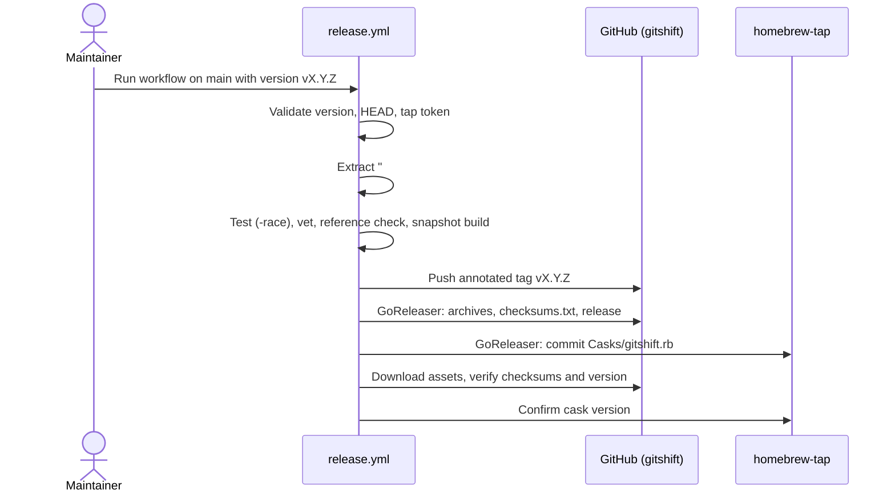

# Releasing

One manually dispatched workflow, `.github/workflows/release.yml`, creates the tag, the GitHub release and the Homebrew cask. Never create release tags by hand.



## One-time setup

1. Create the public repository `techishthoughts-org/homebrew-tap` with a default branch and an empty `Casks/` directory (or just a README; GoReleaser creates `Casks/gitshift.rb`).
2. Create a token that can write only to that repository: a fine-grained personal access token or a GitHub App installation token with **Contents: Read and write** on `homebrew-tap` and nothing else.
3. Add it to `techishthoughts-org/gitshift` as the Actions secret `HOMEBREW_TAP_TOKEN`. The workflow refuses to start without it.

The workflow's own `GITHUB_TOKEN` pushes the tag and publishes the release; the tap token is used only by GoReleaser to commit the cask.

## Cut a release

1. Merge everything for the release to `main` with CI green.
2. Choose a stable version greater than every existing tag (`vMAJOR.MINOR.PATCH`).
3. Open a pull request that renames `## [Unreleased]` in `CHANGELOG.md` to `## [X.Y.Z] - YYYY-MM-DD`, adds a fresh empty `## [Unreleased]` above it, and updates the compare links at the bottom. Merge it. The workflow fails if that dated section is missing, and uses its body as the release notes.
4. Dispatch:

   ```bash
   gh workflow run release.yml --ref main -f version=vX.Y.Z
   gh run watch
   ```

Before anything is published, the workflow checks that it runs from the current `main` HEAD, that the version is strict semver, new, and greater than the latest tag, and that tests, vet, the generated command reference and a full GoReleaser snapshot build all pass. Only then does it push the annotated tag and publish.

## Release contract

| Asset | Targets |
| --- | --- |
| `gitshift_X.Y.Z_<os>_<arch>.tar.gz` | `darwin` and `linux`, `amd64` and `arm64` |
| `gitshift_X.Y.Z_windows_<arch>.zip` | `amd64` and `arm64` |
| `checksums.txt` | SHA-256 of every archive |

Each archive holds `gitshift`, `LICENSE`, `README.md` and `CHANGELOG.md`. The binary reports `gitshift vX.Y.Z`. The cask `Casks/gitshift.rb` in `homebrew-tap` points at the macOS and Linux archives and clears the macOS quarantine attribute on install, because the binaries are not notarized.

## Check the build locally

```bash
make release-check   # goreleaser check + snapshot archives, checksums and cask in dist/
make docs            # regenerate docs/reference/commands after changing commands or flags
```

## Recovery

- **Failure before the tag push** (validation, tests, snapshot build): nothing was published. Fix `main` and dispatch again with the same version.
- **Tag pushed, GoReleaser failed:** do not move or delete the tag. Fix the cause and publish from the existing tag on a clean checkout:

  ```bash
  git checkout vX.Y.Z
  awk -v want=X.Y.Z '/^(## \[|\[[^]]+\]: )/ { if (found) exit; found = index($0, "## [" want "] - ") == 1; next } found' CHANGELOG.md > /tmp/notes.md
  GITHUB_TOKEN=... HOMEBREW_TAP_TOKEN=... goreleaser release --clean --release-notes /tmp/notes.md
  ```

- **Release published, cask missing:** rerun the command above; `release.mode: replace` keeps the existing release and re-uploads matching assets, then GoReleaser commits the cask.
- Never replace assets on an announced release when their provenance is uncertain; publish a new patch version instead.

## Version history

`v1.0.0`–`v1.0.3` are legacy GitHub-only builds that report `v0.1.0`. `v1.1.0`–`v1.4.2` are source-only tags with notes but no binaries. `v2.0.0` is the first release from this pipeline and the first available through Homebrew.
